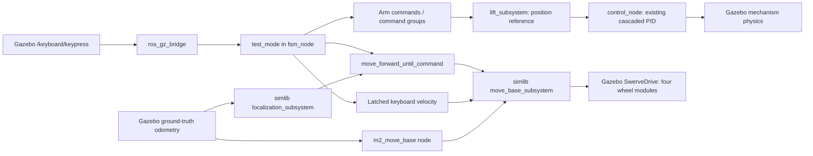

# Simlib integration review

This change follows Commonlib/Oogway's existing division of responsibilities.
`m2_simlib` is a C++ library loaded by `fsm_node`, not a new controller node.
The existing `m2_move_base` executable is launched separately. Gazebo ground
truth supplies localization. Lift and turntable feedback control stays in the
existing `control_node`.

## Runtime design



The lift command selects either a direct position reference or a sine-shaped
reference. Both are tracked by the same physical feedback controller. Selecting
`pid` does not replace the existing cascaded PID with a single loop.

For chassis motion there is exactly one final ROS velocity publisher in FSM mode:
`move_base_subsystem`. The old Gazebo TriggeredPublisher keyboard bindings were
removed from the generator and regenerated SDF so they cannot bypass this selector.

No `m2_chassis_kinematics` package is needed for this robot: the existing Gazebo
SwerveDrive plugin converts body velocity into steering angles and wheel speeds.
This remains a separate layer from path following and command scheduling.

## Files and responsibilities

Paths in this table are relative to `~/ros2_ws/src`.

| File or directory | Responsibility |
|---|---|
| `m2_simlib/CMakeLists.txt`, `cmake/`, `code/CMakeLists.txt` | Commonlib's m2b build structure, renamed package and exported library targets |
| `m2_simlib/code/include/m2_simlib/base/simlib_define.h` | Copied PID/trajectory parameter structures and existing Commonlib types |
| `m2_simlib/code/src/utils/` | Copied PIDController, SinTrajectory and math/conversion helpers |
| `m2_simlib/code/src/ros2/subsystem/localization_subsystem.cpp` | Ground-truth odometry cache, pose/yaw/distance helpers and freshness check |
| `m2_simlib/code/src/ros2/subsystem/move_base_subsystem.cpp` | Velocity priority, stale-input rejection, trajectory registration and service clients |
| `m2_simlib/code/src/ros2/commands/move_base/` | Retained Commonlib `run_traj_command` and `pid_pose_command` interfaces |
| `m2_simlib/launch/move_base.launch.py` | Existing planner node connected to simulation odometry and intermediate velocity topic |
| `m2_simlib/config/` | Empty default trajectory registry and optional reverse-path example |
| `m2_gz_simulation/code/src/base/simulation_robot.cpp` | Registers localization, move-base and chassis subsystems alongside the arm subsystems; releases ROS resources on shutdown |
| `m2_gz_simulation/code/src/subsystems/chassis_subsystem.cpp` | Oogway-style parameter declaration/getter facade, without VESC and active-caster IO |
| `m2_gz_simulation/code/src/commands/chassis/move_forward_until.cpp` | Oogway-style forward command, heading hold and completion predicate |
| `m2_gz_simulation/code/src/commands/lift/set_lift_pos.cpp` | Selects the reference profile, plans from measured position and waits for measured completion |
| `m2_gz_simulation/code/src/subsystems/lift_subsystem.cpp` | ROS profile parameters, limit validation, feedback access and position-reference publication |
| `m2_gz_simulation/code/include/m2_gz_simulation/subsystems/motion_completion.h` | Separates feedback validity from “new sample after request” completion checks |
| `m2_gz_simulation/code/src/modes/test_mode.cpp` | Named keyboard enum mapping, manual velocity latch, cancellation and reset handling |
| `m2_gz_simulation/launch/simulation.launch.py` | Includes simlib's planner launch, passes trajectory registry and remaps subsystem topics |
| `m2_gz_simulation/config/fsm_node_params.yaml` | Default sine lift settings, completion thresholds and forward-command yaw gains |
| `m2_gz_simulation/test/keyboard_command_test.cpp` | Command/group, profile switching, priority, freshness and heading/timeout tests |
| `m2_gz_simulation/test/trajectory_smoke.py` | Real planner registration, physical path following, override and world-reset regression |
| `m2_gz_simulation/test/simulation_smoke.py` | Real grasp/lift/yaw, parameter switching, timed forward, keyboard driving and raw sensor regression |

Command source folders are now `chassis/`, `lift/`, `gripper/`, `yaw/` and
`composite/`, each with its own CMakeLists, matching the organization of the
existing headers. The root commands CMakeLists includes these directories.

## What was copied and what changed

Commonlib's non-ROS utilities, parameter types, message helpers, message
definitions, vendored JSON dependency and build organization are retained.
The namespace and include prefix become `m2::simlib` and `m2_simlib/`.
Legacy KFS/MF helper types remain available; they do not start hardware nodes.

The simulation-specific adaptations are:

- Localization reads `nav_msgs/Odometry`. Estimator pose-reset and correction
  service clients and their commands are removed. There is no new sensor fusion.
- `joy/cmd_vel` becomes `keyboard/cmd_vel`. Body yaw uses `angular.z`.
  Unsupported non-planar Twist components are not forwarded.
- Trajectory registration starts from `tick()` once services are available,
  without blocking the FSM constructor. Delete/add requests are ordered.
  Malformed JSON is logged; an empty registry is supported.
- Commands use subsystem requirements to arbitrate ownership. Retained movement
  commands check ground-truth freshness. The forward example uses ROS simulation
  time for its timeout.
- SinTrajectory retains the Commonlib formula and its 100 Hz phase quantization.
  Zero-distance and sub-tick ramps are guarded. The lift passes zero terminal
  velocity and validates positive finite limits.
- The gripper command previously returned `true` immediately from
  `is_finished()`. It now calls the already-existing `at_target()`, so a
  sequential close-then-lift waits for closed-position or bilateral block contact.

The original `m2_commonlib26`, Oogway, Nezha, `m2_move_base`, arm controller,
swerve plugin, sensor settings and venue geometry are not modified by this work.

## Lift profile configuration

The parameter belongs to `/m2_gz_simulation/fsm_node`.

```bash
ros2 param set /m2_gz_simulation/fsm_node lift.motion_profile sine
ros2 param set /m2_gz_simulation/fsm_node lift.motion_profile pid
ros2 param set /m2_gz_simulation/fsm_node lift.sine.rise.velocity 0.25
```

The default is `sine`. Each command chooses its profile at initialization;
changing the profile during a move affects the next command. Sine limits are
captured when its measured starting position becomes available.

| Parameter | Default | Unit |
|---|---:|---|
| `lift.sine.rise.velocity`, `lift.sine.fall.velocity` | 0.35 | m/s |
| `lift.sine.rise.acceleration`, `lift.sine.fall.acceleration` | 0.6 | m/s² |
| `lift.sine.rise.deceleration`, `lift.sine.fall.deceleration` | 0.6 | m/s² |

For sine motion, initialize captures current lift position, plans the displacement
to the clamped target, and execute publishes `start + trajectory.position(t)`.
The elapsed time comes from the ROS clock, so pausing simulation does not consume
the remaining profile duration. A backward clock jump replans from feedback.
Completion requires both the profile duration and fresh, stationary feedback at
the final position. PID mode sends the final position immediately and still waits
for measured completion.

A new command owns a revision of the lift target. If an old command is interrupted
after its replacement initializes, its cleanup cannot overwrite the newer target.
Ordinary cancellation holds the measured position when fresh feedback is available.
Yaw presets continue using their existing control path.

## Chassis example and velocity selection

`move_forward_until_command` follows Oogway's structure:

1. Its constructor retrieves the chassis, localization and move-base subsystems.
2. Initialize obtains `pid_pose.move_forward_yaw_params`, builds the copied
   PIDController, records current yaw and starts the timer.
3. Execute writes the requested speed to body `linear.x` and heading correction
   to `angular.z`. Oogway's hardware-specific `angular.x` channel is not used.
4. `is_finished()` evaluates the supplied predicate; the timeout constructor
   supplies a predicate based on elapsed simulation time.
5. End sends zero FSM velocity. Invalid/stale odometry also ends the command.

V runs `move_forward_until_command(0.15f, 2000)`. It is a timed movement, not a
distance controller: wheel acceleration makes actual displacement smaller than
0.30 m. The copied PID utility is based on per-cycle gains; its integral and
derivative terms assume the configured control rate. Defaults use P only.

The selector retains Commonlib's policy: **fresh nonzero keyboard > planner >
FSM**, with a 0.2 s input timeout. A zero command relinquishes that source; it is
not a high-priority brake. Timestamp checks use ROS time and receive-age checks
also use a steady clock.

Arrow/Z/C input is latched because Gazebo supplies keypress but no release event.
The mode refreshes its manual velocity every tick. These keys cancel the V
example and stop an active planner trajectory. X clears manual motion, cancels V
and stops the planner. V clears manual input before starting. A world reset
clears the manual latch. The explicit stop path clears cached velocities and
disables planner output until the subsystem's next `run_trajectory()`.

An external `keyboard/cmd_vel` publisher can temporarily override a lower source;
send a heartbeat faster than 5 Hz. Stop publishing or publish zero to relinquish.
This priority override does not pause the lower command's timer.

## Trajectory registration and planner integration

The default registry is empty. Load the supplied example with:

```bash
ros2 launch m2_gz_simulation simulation.launch.py \
  trajectory_config:=$HOME/ros2_ws/src/m2_simlib/config/example_trajectories.json
```

The registry has Commonlib's `config_paths` array: each entry contains an ID,
a profile JSON path and a controller JSON path, relative to the registry.
The example registers `demo_reverse`, a short path from the default spawn
`(3.70, 3.85)` to `(3.40, 3.85)`. Registration alone never starts movement.

The retained API is `add_trajectory`, `run_trajectory`, `stop_trajectory`,
`delete_trajectory`, `has_trajectory` and `get_path_config`. Use
`simlib::run_traj_command` from a mode to schedule a registered path using FSM
requirements. It waits for registration and fresh odometry before sending the
request, then uses endpoint distance and the inherited blocked-motion check.
An unknown/unregistered ID remains waiting until cancelled; service rejection is
logged. This retained wrapper does not provide an action-style success/failure
result or a general navigation stack.

The demonstration profile uses a fixed path speed and pure-PID orientation and
stop controllers. Commonlib's wrapper also reads `stop_controller.deadzone`
as its positional completion threshold. The existing pure-PID stop controller
corrects position only; it does not finish by correcting chassis yaw. Avoid the
hardware differential controller for this swerve interface: its extra
`angular.x` channel is intentionally excluded.

The trajectory smoke test invokes the planner's run service before any manual
stop to check registration and the full IO path. For normal FSM code, call the
subsystem API; after X, directly calling the planner's ROS run service does not
re-enable the selector's planner input.

| Connection | ROS name in this launch |
|---|---|
| Ground truth consumed by both nodes | `/m2_gz_simulation/chassis/odometry` |
| External manual velocity input | `/m2_gz_simulation/keyboard/cmd_vel` |
| Planner's intermediate velocity | `/m2_gz_simulation/move_base/cmd_vel` |
| Single final swerve velocity output | `/m2_gz_simulation/chassis/cmd_vel` |
| Planner services | `/m2_gz_simulation/move_base/{add,run,stop,delete}_trajectory` |

Simlib's `chassis_odom` and `cmd_vel` names are remapped by the launch file.
The planner launch is also usable separately via
`ros2 launch m2_simlib move_base.launch.py` when a simulation is already
supplying odometry. Do not launch a duplicate alongside the full FSM launch.

## Build and validation

```bash
cd ~/ros2_ws
source /opt/ros/jazzy/setup.bash
colcon build --packages-up-to m2_gz_simulation --cmake-args -DBUILD_TESTING=ON
source install/setup.bash
colcon test --packages-select m2_gz_simulation
colcon test-result --test-result-base build/m2_gz_simulation --verbose
python3 src/m2_gz_simulation/test/trajectory_smoke.py
python3 src/m2_gz_simulation/test/simulation_smoke.py --mode all
```

The tests use isolated ROS domain IDs and Gazebo partitions. Run the two physics
scripts sequentially. They require working local ROS/Gazebo transport sockets.

The review run results are recorded in `~/ros2_ws/log/simlib_validation/`.

Validated on 2026-10-23:

| Check | Result |
|---|---|
| Build of both changed packages | Passed |
| Colcon test results | 25 tests, zero errors/failures/skips |
| Registered reverse path | Reached x = 3.4191 m for target x = 3.4000 m, within the test's 2 cm tolerance |
| Timed forward command | Moved 0.2781 m and stopped; manual cancellation also passed |
| Loaded sine lift | Block centre reached 1.2741 m; payload retained through both yaw presets |
| Runtime PID/sine switch | Passed without restarting nodes |
| FSM, direct-position and direct-effort physics regressions | All passed with clean shutdown |
| Reset during keyboard driving | Latched velocity cleared; robot remained at reset pose |
